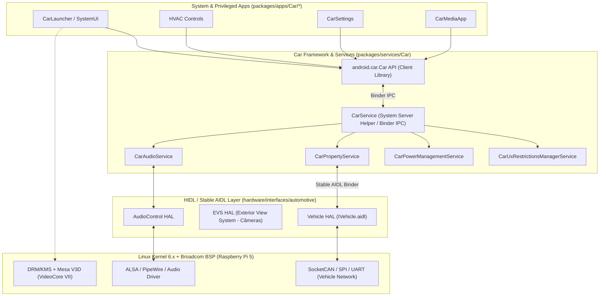
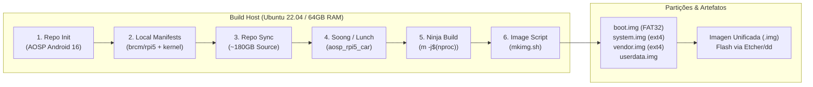

# Instruções da Apresentação: Android Automotive OS (AAOS) — Technical Overview & Build on Raspberry Pi 5 (Android 16)

**Tema:** Android Automotive: An Overview (Arquitetura AOSP, Internals e Build do Android 16 na Raspberry Pi 5)  
**Público-Alvo:** Engenheiros de Software, Desenvolvedores Android/Embarcados e Arquitetos de Sistemas  
**Duração Total:** 45 minutos (38–40 min técnicos + 5–7 min de Q&A)  
**Referência Técnica Base:** [Build AOSP Android 16 Automotive OS for Raspberry Pi 5 and flash it (Make Android - Medium)](https://medium.com/make-android/build-aosp-android-16-automotive-os-for-raspberry-pi-5-and-flash-it-cc24efd24410)

---

## 1. Cronograma Executivo (Foco Técnico - 45 min)

| Bloco | Seção | Tempo | Slides | Foco Técnico Principal |
| :--- | :--- | :---: | :---: | :--- |
| **Bloco 1** | Introdução Técnica: Ecossistema AAOS & Stack Automotivo | 06 min | 1 a 3 | Diferenças arquiteturais AAOS vs. Mobile, Treble, GAS e motivação do target ARM64 (RPi 5) |
| **Bloco 2** | Deep Dive: Arquitetura Interna do AAOS (CarService & VHAL) | 12 min | 4 a 8 | `CarService`, `CarPropertyManager`, AIDL VHAL, Audio Zones, Power Policy e UX Restrictions |
| **Bloco 3** | Engenharia do Build: AOSP Android 16 para Raspberry Pi 5 | 15 min | 9 a 15 | `repo`, `local_manifests` (Device Tree/Kernel/Mesa), Soong/Ninja, `lunch` target e empacotamento de partições |
| **Bloco 4** | Demo, Debugging & Desafios de Bring-up na RPi 5 | 07 min | 16 a 18 | Boot flow, `adb` / Serial UART, aceleração gráfica (`drm_hwcomposer` + VideoCore VII) e consumo de recursos |
| **Bloco 5** | Próximos Passos de Engenharia & Q&A | 05 min | 19 a 20 | Customização via RROs, integração VHAL $\leftrightarrow$ SocketCAN/MCP2515 e perguntas técnicas |

---

## 2. Roteiro Slide a Slide (Conteúdo Técnico, Diagramas e Notas do Apresentador)

---

### BLOCO 1: Introdução Técnica — Ecossistema AAOS & Stack Automotivo (06 min)

#### Slide 1: Capa
* **Título:** Android Automotive OS (AAOS): Technical Overview & Bring-up
* **Subtítulo:** Da arquitetura interna do AOSP à compilação do Android 16 em hardware Raspberry Pi 5 (ARM64)
* **Notas do Apresentador:**
  * Apresentar o objetivo direto da sessão: dissecar a arquitetura do Android Automotive OS sob a ótica de engenharia de plataforma (AOSP) e demonstrar todo o pipeline de construção (*bring-up*, *build* e *flashing*) do nosso produto baseado no Android 16 rodando nativamente em uma Raspberry Pi 5.

#### Slide 2: Android Auto vs. AAOS (AOSP) vs. GAS — Visão de Sistema
* **Conteúdo do Slide:**
  * **Android Auto (Projection):** O head-unit atua apenas como um *sink* de vídeo (H.264/H.265) e *source* de input (touch/botões) via USB/Wi-Fi. Todo o processamento roda no smartphone.
  * **AAOS (Android Automotive OS):** Sistema operacional completo compilado a partir do AOSP (`packages/services/Car`, `hardware/interfaces/automotive`). Roda nativamente no SoC do veículo, gerenciando múltiplos displays, áudio multizona e comunicação direta com o barramento CAN via VHAL.
  * **GAS (Google Automotive Services):** Camada proprietária (GMS para carros: Maps, Play Store, Assistant) instalada sobre o AAOS mediante certificação CTS/VTS automotiva.
* **Notas do Apresentador:**
  * Destacar que nosso produto foca na base **AOSP Android 16 AAOS**, o que nos concede controle total sobre o *init*, SELinux, HALs, SystemUI e políticas do veículo, sem dependência de licenciamento proprietário para prototipação e produtos customizados.

#### Slide 3: Por que Raspberry Pi 5 como Plataforma de Desenvolvimento AAOS?
* **Conteúdo do Slide:**
  * **Emulador (`sdk_car_x86_64`) vs. Target Real (`rpi5` ARM64):**
    * O emulador Cuttlefish/Goldfish roda sobre `x86_64` (ou virtualização host) com HALs puramente sintéticos (`virtio`).
    * **Raspberry Pi 5 (Broadcom BCM2712):** Cortex-A76 Quad-Core 64-bit (`arm64-v8a`), GPU VideoCore VII (suporte OpenGL ES 3.1 / Vulkan 1.2 via Mesa V3D), barramento PCIe 2.0 (NVMe), SPI/I2C/UART expostos no header de 40 pinos.
  * **Vantagem de Engenharia:** Permite validar cross-compilation real, integração de Kernel Linux + Device Tree (`.dts`), KMS/DRM display pipeline e conexão física com transceptores CAN.

---

### BLOCO 2: Deep Dive — Arquitetura Interna do AAOS (12 min)

#### Slide 4: Arquitetura em Camadas do AAOS no Android 16
* **Diagrama Técnico:**

* **Notas do Apresentador:**
  * Explicar a separação introduzida pelo *Project Treble*: o framework do Android conversa com os serviços automotivos via Binder IPC, e o `CarService` conversa com o processo nativo do `VHAL` através de interfaces **Stable AIDL** (`android.hardware.automotive.vehicle.IVehicle`).

#### Slide 5: `CarService` e o Modelo de Propriedades (`CarPropertyManager`)
* **Conteúdo do Slide:**
  * Diretório no AOSP: `packages/services/Car/service/`
  * Todo estado físico do carro é modelado como uma **Propriedade tipada** definida em `VehicleProperty.aidl`:
    * Exemplo 1: `PERF_VEHICLE_SPEED` (`0x11600207` — Tipo `FLOAT`, Acesso `READ`, Modo `CONTINUOUS`).
    * Exemplo 2: `HVAC_TEMPERATURE_SET` (`0x15600503` — Tipo `FLOAT`, Acesso `READ_WRITE`, Área `VehicleAreaSeat`).
    * Exemplo 3: `GEAR_SELECTION` (`0x11400400` — Tipo `INT32`, Acesso `READ`, Modo `ON_CHANGE`).
  * **Fluxo de Leitura/Escrita:**
    ```java
    Car car = Car.createCar(context);
    CarPropertyManager propMgr = (CarPropertyManager) car.getCarManager(Car.PROPERTY_SERVICE);
    propMgr.registerCallback(callback, VehiclePropertyIds.PERF_VEHICLE_SPEED, CarPropertyManager.SENSOR_RATE_UI);
    ```
* **Notas do Apresentador:**
  * Ressaltar que o aplicativo Android nunca acessa `/dev/can0` ou sockets diretamente. Ele consome propriedades abstraídas pelo `CarPropertyManager`, que valida permissões granuladas (ex.: `android.car.permission.CAR_SPEED`, `android.car.permission.CONTROL_CAR_CLIMATE`).

#### Slide 6: VHAL (Vehicle Hardware Abstraction Layer) em AIDL
* **Conteúdo do Slide:**
  * Diretório no AOSP: `hardware/interfaces/automotive/vehicle/aidl/`
  * No Android 16, o VHAL utiliza **Stable AIDL** (substituindo o antigo HIDL `2.0`).
  * **Arquitetura do Reference VHAL:**
    * `DefaultVehicleHal`: Implementação C++ que gerencia assinaturas, *polling* e despacho de eventos (`onPropertyEvent`).
    * `JsonFakeValueGenerator` / `DefaultConfig.json`: Em bancadas como a Raspberry Pi 5 sem um chassi real conectado, o VHAL carrega configurações JSON que simulam os valores iniciais das propriedades e permitem injeção de eventos via `adb shell dumpsys android.hardware.automotive.vehicle.IVehicle/default`.

#### Slide 7: Subsistema de Áudio Automotivo e Gerenciamento de Energia
* **Conteúdo do Slide:**
  * **CarAudioService & Dynamic Audio Zones:**
    * Diferente do celular (1 usuário, 1 saída ativa), o AAOS suporta **Multi-Zone Audio** (`car_audio_configuration.xml`), roteando streams independentes para o motorista (ex.: navegação) e passageiros traseiros (ex.: mídia) com *Audio Ducking* controlado em hardware/HAL.
  * **CarPowerManagementService (CPMS) & Garage Mode:**
    * Gerencia estados de energia automotivos (`WAIT_FOR_VHAL`, `ON`, `SHUTDOWN_PREPARE`, `SUSPEND_TO_RAM` / *Deep Sleep*).
    * **Garage Mode:** Janela de manutenção em background acionada quando o motorista desliga a ignição, permitindo OTA updates e sincronização antes de cortar a bateria 12V.

#### Slide 8: Restrições de UX (`CarUxRestrictions`) e Multi-User
* **Conteúdo do Slide:**
  * **Prevenção de Distração do Motorista:**
    * O `CarDrivingStateService` monitora `PERF_VEHICLE_SPEED` e `GEAR_SELECTION` vindos do VHAL para inferir o estado: `PARKED`, `IDLING` ou `MOVING`.
    * Quando `MOVING`, o `CarUxRestrictionsManagerService` dispara eventos para a `SystemUI` e aplicativos: bloqueia entrada de texto livre, oculta configurações complexas e limita o comprimento de listas (`UX_RESTRICTIONS_NO_KEYBOARD`, `UX_RESTRICTIONS_NO_VIDEO`).
  * **Headless System User Mode (HSUM):**
    * No AAOS, o `User 0` (`SYSTEM`) roda em background (*headless*), enquanto o motorista logado é sempre um usuário secundário (`User 10+`), garantindo isolamento de dados entre diferentes motoristas do mesmo veículo.

---

### BLOCO 3: Engenharia do Build — AOSP Android 16 para Raspberry Pi 5 (15 min)

#### Slide 9: Pipeline Completo de Compilação e Geração de Imagem
* **Diagrama do Pipeline:**


#### Slide 10: Passo 1 — Dimensionamento do Host de Build e Dependências
* **Conteúdo do Slide:**
  * **Requisitos Críticos do Host (Por que o build falha em máquinas comuns?):**
    * **RAM:** Mínimo 32 GB + 32 GB Swap (Recomendado: **64 GB RAM**). O compilador Rust/Clang e o empacotador `soong_ui` / `metalava` consomem ~2.5 GB por thread durante a fase de linkagem.
    * **CPU:** 16+ threads (ex.: AMD Ryzen 9 / Threadripper / Xeon).
    * **Storage:** +500 GB NVMe SSD (~180 GB para `.repo` e *working tree* + ~250 GB para o diretório `out/`).
  * **Pacotes Base de Compilação (Ubuntu 22.04 LTS):**
    ```bash
    sudo apt update && sudo apt install -y git-core gnupg flex bison build-essential \
      zip curl zlib1g-dev libc6-dev-i386 libncurses5 x11proto-core-dev libx11-dev \
      libgl1-mesa-dev libxml2-utils xsltproc unzip fontconfig python3 python-is-python3 \
      openjdk-17-jdk libssl-dev rsync meson ninja-build kpartx parted dosfstools mtools
    ```
    *(Destaque técnico: `meson` e `ninja-build` são necessários para compilar o Mesa3D do driver gráfico da RPi 5; `kpartx`, `parted` e `dosfstools` são usados para montar a tabela de partições da imagem final).*

#### Slide 11: Passo 2 — Inicialização do AOSP Android 16 via `repo`
* **Conteúdo do Slide:**
  * Configuração do binário `repo`:
    ```bash
    mkdir -p ~/.bin && curl https://storage.googleapis.com/git-repo-downloads/repo > ~/.bin/repo
    chmod a+rx ~/.bin/repo && export PATH="${HOME}/.bin:${PATH}"
    ```
  * Inicialização do manifesto base do Android 16:
    ```bash
    mkdir -p ~/aosp-rpi5-android16 && cd ~/aosp-rpi5-android16
    repo init -u https://android.googlesource.com/platform/manifest -b android-16.0.0_r1
    ```
  * **Como o `repo` estrutura o workspace:** Cria o diretório oculto `.repo/manifests/` contendo a referência para mais de 1.100 projetos Git do ecossistema Android.

#### Slide 12: Passo 3 — Injetando o BSP da Raspberry Pi 5 via `local_manifests`
* **Conteúdo do Slide:**
  * **O Problema:** O manifesto oficial da Google contém targets para Pixel e Cuttlefish, mas **não** inclui suporte ao SoC Broadcom BCM2712 da Raspberry Pi 5.
  * **A Solução (`local_manifests`):** Adicionar manifestos complementares em `.repo/local_manifests/` (baseados nos projetos *Raspberry Vanilla / KonstaKANG / arpi-16*):
    ```bash
    git clone https://github.com/raspberry-vanilla/android_local_manifest .repo/local_manifests -b android-16.0
    # Sincronização otimizada (apenas branch atual, sem tags pesadas):
    repo sync -c --no-clone-bundle --no-tags -j$(nproc)
    ```
  * **O que o `local_manifests` adiciona à árvore do AOSP?**
    * `device/brcm/rpi5`: Configurações de produto (`aosp_rpi5.mk`, `aosp_rpi5_car.mk`), `BoardConfig.mk`, `fstab.rpi5` e políticas SELinux.
    * `kernel/brcm/rpi`: Kernel Linux 6.x com patches para BCM2712, Device Trees (`bcm2712-rpi-5-b.dtb`) e overlays (`vc4-kms-v3d-pi5.dtbo`).
    * `external/mesa3d`: Stack gráfico OpenGL ES / Vulkan (`v3d` / `vc4`) integrado ao `drm_hwcomposer`.

#### Slide 13: Passo 4 — Anatomia do Target `aosp_rpi5_car` e Comando `lunch`
* **Conteúdo do Slide:**
  * Inicialização do ambiente e seleção do target:
    ```bash
    source build/envsetup.sh
    lunch aosp_rpi5_car-bp1a-userdebug
    ```
  * **Como o `aosp_rpi5_car.mk` transforma o Android normal em AAOS?**
    * Herda as configurações base de hardware da placa (`device/brcm/rpi5/aosp_rpi5.mk`).
    * Herda o core automotivo da Google:
      ```makefile
      $(call inherit-product, packages/services/Car/car_product/build/car.mk)
      ```
    * Declara a feature de hardware automotiva (`android.hardware.type.automotive.xml`), desabilitando comportamentos exclusivos de smartphone (como rotação de tela por acelerômetro ou discador celular padrão) e ativando o `CarService`, `CarLauncher`, `Cluster` e `VHAL`.
  * **Por que `userdebug`?** Mantém o SELinux em modo *enforcing*, mas habilita `adb root`, `remount` e ferramentas de diagnóstico como `perfetto` e `dumpsys`.

#### Slide 14: Passo 5 — Compilação com Soong/Ninja e Artefatos Gerados
* **Conteúdo do Slide:**
  * Disparo da compilação completa:
    ```bash
    m -j$(nproc)
    ```
  * **Fases Internas do Build:**
    1. Conversão de `Android.mk` legados e leitura dos arquivos `Android.bp` pelo **Blueprint/Soong**.
    2. Geração do grafo de build massivo (`out/combined-aosp_rpi5_car.ninja`).
    3. Compilação cruzada (`aarch64-linux-android-clang`) do framework, APKs, serviços nativos e HALs.
  * **Artefatos gerados em `out/target/product/rpi5/`:**
    * `boot.img`: Partição FAT32 contendo o firmware da Raspberry Pi (`config.txt`, `cmdline.txt`), Kernel (`Image.gz`), `ramdisk.img` e Device Trees (`.dtb`/`.dtbo`).
    * `system.img`: Framework Android 16, `CarService` e apps de sistema (`ext4`).
    * `vendor.img`: Binários específicos do SoC Broadcom, Mesa3D, HALs (`IVehicle`, Audio, Gatekeeper, Keymint).
    * `userdata.img`: Partição de dados do usuário.

#### Slide 15: Passo 6 — Empacotamento da Imagem Única e Flashing no SD/NVMe
* **Conteúdo do Slide:**
  * **Por que a Raspberry Pi 5 não usa `fastboot flash` no primeiro boot?**
    * O bootloader na EEPROM da RPi 5 procura uma partição primária **MBR/FAT32** no cartão MicroSD ou SSD NVMe contendo `config.txt` e o Kernel.
  * **Script de Montagem de Imagem (`rpi5-mkimg.sh`):**
    * Cria um arquivo bruto vazio (ex.: 16 GB via `dd` ou `fallocate`).
    * Particiona via `parted` (Partição 1: `boot` FAT32 128MB; Partição 2: `system` EXT4; Partição 3: `vendor` EXT4; Partição 4: `userdata` EXT4).
    * Mapeia as partições via `kpartx -av` / `losetup` e copia o conteúdo de `boot.img`, `system.img` e `vendor.img` via `dd`:
      ```bash
      ./rpi5-mkimg.sh
      # Resultado: out/target/product/rpi5/aosp_rpi5_car-android16.img
      ```
  * **Gravação Física (Flashing):**
    * Escrita direta no MicroSD/NVMe usando **BalenaEtcher**, **Raspberry Pi Imager** (Use Custom) ou via terminal:
      ```bash
      sudo dd if=out/target/product/rpi5/aosp_rpi5_car-android16.img of=/dev/sdX bs=4M status=progress conv=fsync
      ```

---

### BLOCO 4: Demo, Debugging & Desafios de Bring-up na RPi 5 (07 min)

#### Slide 16: Demonstração Técnica & Sequência de Boot
* **Conteúdo do Slide:**
  * **Boot Sequence na Raspberry Pi 5:**
    1. `SPI EEPROM Bootloader` lê a partição 1 (`FAT32`) e processa o `config.txt`.
    2. Carrega `Image.gz` (Kernel), `ramdisk.img` e aplica o overlay `vc4-kms-v3d-pi5.dtbo`.
    3. `init` (First Stage) monta `system` e `vendor` a partir de `/dev/block/mmcblk0p2` e `p3` (definidos em `fstab.rpi5`).
    4. `init` (Second Stage) carrega políticas SELinux, inicia os serviços AIDL (`vendor.vehicle-hal-default`) e o `Zygote64`.
    5. `SystemServer` inicia o `CarService`, que faz bind no `VHAL` e lança o `CarLauncher`.
  * **Demo ao Vivo / Vídeo:**
    * Interação com o **CarLauncher**, barra de **HVAC**, perfis multi-usuário e inspeção via terminal (`adb shell`).

#### Slide 17: Debugging e Inspeção em Tempo Real (`adb` & `dumpsys`)
* **Conteúdo do Slide:**
  * Comandos essenciais que usamos para validar e depurar o nosso produto AAOS na RPi 5:
    ```bash
    # Conectar via ADB over Network (Wi-Fi/Ethernet na RPi 5)
    adb connect <IP_DA_RPI5>:5555

    # Listar todos os serviços automotivos ativos
    adb shell dumpsys car_service

    # Inspecionar propriedades do VHAL em tempo real
    adb shell dumpsys android.hardware.automotive.vehicle.IVehicle/default --list

    # Simular mudança de velocidade ou temperatura via CLI (Injeção VHAL)
    adb shell cmd car_service inject-vhal-event 0x11600207 65.0
    ```
* **Notas do Apresentador:**
  * Mostrar como o comando `cmd car_service inject-vhal-event` permite testar o comportamento da UI (ex.: simular que o carro atingiu 65 km/h e ver o `CarUxRestrictions` bloquear configurações na tela instantaneamente).

#### Slide 18: Gargalos e Lições Aprendidas no Bring-up da Raspberry Pi 5
* **Conteúdo do Slide:**
  * **1. Alimentação Elétrica (USB-C PD 5.1V / 5A):** A RPi 5 sob carga gráfica no boot do Android 16 sofre *brownout* ou queda de frequência se usada com fontes comuns de 5V/3A.
  * **2. Pipeline Gráfico (`config.txt` + KMS/DRM):** Ajustes de resolução EDID no `config.txt` (`hdmi_group`, `dtoverlay=vc4-kms-v3d-pi5`) para evitar tela preta em monitores ultrawide ou touchscreens automotivos.
  * **3. Performance de I/O (MicroSD vs. NVMe):** O Android 16 realiza intenso I/O aleatório no `userdata` (SQLite, ART dexopt). Cartões SD lentos causam *stuttering*; o uso de MicroSD Classe A2 ou boot via SSD NVMe melhora drasticamente o tempo de boot.

---

### BLOCO 5: Próximos Passos de Engenharia & Q&A (05 min)

#### Slide 19: Evolução Técnica do Nosso Produto (Roadmap)
* **Conteúdo do Slide:**
  * **1. Integração CAN Bus Real (Hardware-in-the-Loop):**
    * Conectar um transceptor MCP2515 (SPI) ou interface USB-CAN na Raspberry Pi 5, levantar a interface Linux `SocketCAN` (`can0`) e implementar uma thread de leitura/escrita no nosso `VHAL` C++ para traduzir frames CAN (OBD-II / J1939) em `VehiclePropValue`.
  * **2. Customização OEM sem modificar o Framework (RROs):**
    * Uso de *Runtime Resource Overlays* (`car-ui-lib`) para aplicar identidade visual própria em todo o sistema mantendo compatibilidade com atualizações do AOSP.
  * **3. Fastboot / OTA Updates (A/B Seamless):**
    * Evolução do layout de partições para suportar atualizações *Over-The-Air*.

#### Slide 20: Conclusão & Q&A Técnico
* **Pontos-Chave para Fechamento:**
  * Dominar o ciclo completo do **AOSP Android 16** em hardware **ARM64 (Raspberry Pi 5)** coloca nossa engenharia no mesmo patamar de arquitetura utilizado pelas grandes OEMs e Tier-1s automotivos.
  * Temos uma bancada funcional, extensível no nível de Kernel/HAL e pronta para integração com redes veiculares reais.
* **Abertura para Perguntas Técnicas.**

---

## 3. Checklist Técnico para a Demonstração
- [ ] **Terminal aberto com SSH/ADB conectado na RPi 5:** Deixar um terminal pronto com `adb shell cmd car_service inject-vhal-event` no histórico para demonstrar a reação da interface a comandos de baixo nível ao vivo.
- [ ] **Exibir trechos reais de código/configuração:** Ter capturas ou abas abertas com o `local_manifests` XML, o `aosp_rpi5_car.mk` e o `config.txt` da partição de boot.
- [ ] **Vídeo de fallback:** Manter um vídeo curto em `.mp4` mostrando o boot e a injeção de eventos no VHAL caso a rede Wi-Fi do local bloqueie a porta `5555` do ADB (ou usar cabo USB/Ethernet direto).

---

## 4. Cheat Sheet de Comandos para a Live Demo (ADB + VHAL)

Durante o **Bloco 4 (Slides 16 e 17)**, você pode executar estes comandos ao vivo no terminal conectado à Raspberry Pi 5 para demonstrar o funcionamento interno do Android 16 AAOS:

```bash
# 1. Conectar via ADB over Network e obter privilégios de root (disponível em userdebug)
adb connect <IP_DA_RPI5>:5555
adb root

# 2. Verificar a versão do Android 16 e o target compilado
adb shell getprop ro.build.Flavor
adb shell getprop ro.build.version.release

# 3. Listar serviços automotivos e estado atual de direção (PARKED / MOVING)
adb shell dumpsys car_service --services CarDrivingStateService

# 4. Simular veículo entrando em movimento (18.0 m/s = ~65 km/h) -> Ativa UX Restrictions na tela!
# 0x11400400 = GEAR_SELECTION (8 = GEAR_DRIVE)
# 0x11600207 = PERF_VEHICLE_SPEED (float em m/s)
adb shell cmd car_service inject-vhal-event 0x11400400 8
adb shell cmd car_service inject-vhal-event 0x11600207 18.0

# 5. Voltar o veículo para Estacionado (0.0 m/s e GEAR_PARK = 4) -> Libera o teclado e menus!
adb shell cmd car_service inject-vhal-event 0x11600207 0.0
adb shell cmd car_service inject-vhal-event 0x11400400 4

# 6. Alterar a temperatura do Ar-Condicionado (HVAC) via linha de comando (Área 1 = Motorista, 21.5 °C)
# 0x15600503 = HVAC_TEMPERATURE_SET
adb shell cmd car_service inject-vhal-event 0x15600503 1 21.5

# 7. Alternar Modo Noturno Automotivo (0x11200207 = NIGHT_MODE)
adb shell cmd car_service inject-vhal-event 0x11200207 true
```

---

## 5. Guia de Bolso para o Q&A Técnico (Possíveis Perguntas da Plateia)

Como o público-alvo é técnico, estas são as perguntas mais prováveis ao final da apresentação e as respostas de engenharia recomendadas:

### P1: "Como a GPU da Raspberry Pi 5 roda o Android 16 sem blobs proprietários da Broadcom?"
* **Resposta:** Diferente das gerações antigas (RPi 3), a Raspberry Pi 5 utiliza a GPU **VideoCore VII**, cujo suporte gráfico no Linux moderno e no AOSP é feito pela stack open-source **Mesa3D** (drivers `v3d` para OpenGL ES 3.1 / Vulkan 1.2 e `vc4` para display KMS). No nosso build, o `external/mesa3d` trabalha junto com o `drm_hwcomposer` e o `minigbm` para entregar composição de telas acelerada por hardware ao `SurfaceFlinger`.

### P2: "Por que um aplicativo comum não pode acessar o VHAL diretamente?"
* **Resposta:** Por isolamento de segurança (*Project Treble* e SELinux) e controle de concorrência. Apenas processos de sistema como o `CarService` possuem permissão de SELinux (`hal_vehicle_client`) para abrir comunicação Binder com o serviço nativo `IVehicle`. Aplicativos consomem a `Car API` (`CarPropertyManager`), onde o `CarService` aplica permissões do manifesto do Android, filtra taxas de amostragem e protege propriedades críticas de escrita.

### P3: "Como funciona a integração real com o barramento CAN na Raspberry Pi 5?"
* **Resposta:** A arquitetura do Reference VHAL no Android 16 desacopla o servidor IPC (`DefaultVehicleHal`) da interface de hardware (`IVehicleHardware`). Na Raspberry Pi 5, conectamos um módulo CAN (ex.: **MCP2515 via SPI** nos pinos GPIO ou um transceptor USB-CAN), subimos a interface nativa do Kernel Linux via **SocketCAN** (`can0`) e implementamos uma classe C++ que herda de `IVehicleHardware`, lendo frames CAN de um socket padrão e convertendo para `VehiclePropValue`.

### P4: "Em carros reais, a câmera de ré precisa abrir em menos de 2 segundos ao dar a partida. Como o AAOS resolve o tempo de boot do Android?"
* **Resposta:** Existem duas estratégias no AAOS:
  1. **Suspend-to-RAM (Deep Sleep):** No dia a dia, o `CarPowerManagementService` não desliga o Android completamente; ele suspende a sessão na memória RAM, permitindo *wake-up* em ~1 a 2 segundos.
  2. **EVS (Exterior View System):** Para o caso de *cold boot*, o subsistema `EVS HAL` é um serviço nativo C++ que inicia muito antes do `Zygote` e do `SystemServer` subirem, conseguindo acessar o driver de vídeo V4L2/DRM e renderizar a câmera de ré na tela nos primeiros segundos do boot.

### P5: "Como customizar a interface (Launcher, SystemUI, HVAC) para a nossa marca sem quebrar atualizações futuras do AOSP?"
* **Resposta:** Utilizando **RROs (Runtime Resource Overlays)** estáticos ou dinâmicos combinados com a `car-ui-lib`. Em vez de alterar os arquivos XML/código dentro de `packages/apps/Car/SystemUI`, criamos pacotes de overlay no nosso diretório `device/brcm/rpi5/overlay/` que substituem cores, dimensões, layouts da barra de HVAC e ícones em tempo de compilação ou execução.

